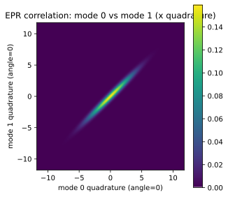
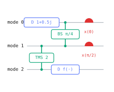
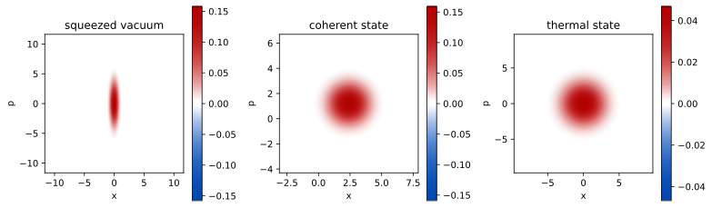

# cvcircuit

[](https://github.com/neago/CVcircuit/actions/workflows/ci.yml)


A small, readable simulator for **Gaussian continuous-variable quantum
optics**, built on NumPy — states, symplectic operations, loss/noise
channels, and homodyne/heterodyne/general-dyne measurements, with a plain
Python API instead of a domain-specific language.

- **States**: vacuum, coherent, squeezed, thermal, two-mode squeezed (EPR),
  CV cluster/graph states, arbitrary random states.
- **Operations**: displacement, rotation, squeezing, beamsplitters,
  two-mode squeezing, passive interferometers, CV cluster-state gates
  (CZ/CX), and any custom symplectic transform.
- **Channels**: loss, phase-insensitive amplification, excess noise, and an
  *exact*, honestly non-Gaussian treatment of phase noise (see
  [Conventions](docs/conventions.md)).
- **Measurements**: homodyne, heterodyne, and general-dyne, with detector
  efficiency and electronic noise.
- **Quantum information**: fidelity (arbitrary multimode Gaussian states),
  entropies, logarithmic negativity, PPT/Simon and Duan separability
  criteria, Gaussian steering, and more.
- **Visualization**: Wigner/Husimi/P-function phase-space plots, EPR
  correlation plots, uncertainty ellipses — and circuit diagrams as
  Unicode text art *or* styled SVG/PNG/PDF.
- **ħ is a keyword, not a hard-coded assumption** — every state and circuit
  takes `hbar=` (default 2), so results compare directly against whichever
  convention your paper, lab, or other tool uses.

Built as a sibling to [`qcircsim`](https://github.com/neago/sciqis-qcircsim-claude)
(the discrete-variable version) and cross-checked against an independent
truncated-Fock-space simulator in the test suite. Gaussian-only for now —
non-Gaussian states and operations are a planned extension.

## Installation

```bash
pip install git+https://github.com/neago/CVcircuit.git
```

For local development:

```bash
git clone https://github.com/neago/CVcircuit.git
cd CVcircuit
uv sync --all-extras
uv run pytest
```

## Quickstart

Two ways to work — chain `GaussianState` methods for quick interactive use
(every method returns a *new* state):

```python
import numpy as np
from cvcircuit import squeezed, vacuum

s = squeezed(1.0) & vacuum()                       # tensor product, 2 modes
s = s.beamsplitter(np.pi / 4, modes=(0, 1)).loss(0.1, mode=0)

print(s.symplectic_eigenvalues_snu())               # [1.     1.5386]  (vacuum = 1)
print(s.reduced([1]).squeezing_db(0))                # -2.459   (dB, negative = squeezed)
```

...or build a `Circuit` for a reproducible, drawable, sampleable program:

```python
from cvcircuit import Circuit

c = Circuit(2)
c.squeeze(1.0, mode=0).beamsplitter(np.pi / 4, modes=(0, 1)).loss(0.1, mode=0)
c.homodyne(0, label="x")

print(c)
```

```text
mode 0: [S 1][BS π/4][η 0.1][x(0)]
                │
mode 1: ─────[BS π/4]─────────────
```

```python
result = c.run(shots=10_000, seed=0)
print(result.mean("x"), result.var("x"))
```

## Showcase

**Squeezing degradation under loss** — every physical channel here is an
explicit, testable `(X, Y)` map (see [Conventions](docs/conventions.md)):

```python
from cvcircuit import squeezed

for eta in [1.0, 0.9, 0.7, 0.5]:
    s = squeezed(1.0).loss(eta, mode=0)
    print(f"eta={eta}: {s.squeezing_db(0):.2f} dB")
# eta=1.0: -8.69 dB
# eta=0.9: -6.54 dB
# eta=0.7: -4.04 dB
# eta=0.5: -2.46 dB
```

**EPR entanglement, homodyne conditioning, and phase space:**

```python
from cvcircuit import two_mode_squeezed
from cvcircuit import visualization as viz

epr = two_mode_squeezed(1.2)
outcome, conditional = epr.homodyne(mode=0, angle=0.0)
viz.plot_joint_marginal(epr, (0, 0.0), (1, 0.0))   # correlated x-quadratures
```



**CV teleportation**, using a callable gate parameter for feedforward
(it receives the dict of measurement outcomes recorded so far):

```python
c = Circuit(3)
c.displace(1 + 0.5j, mode=0)
c.two_mode_squeeze(2.0, modes=(1, 2))
c.beamsplitter(np.pi / 4, modes=(0, 1))
c.homodyne(0, angle=0.0, label="xA")
c.homodyne(1, angle=np.pi / 2, label="pB")
c.displace(lambda m: (m["xA"] + 1j * m["pB"]) / np.sqrt(2), mode=2)
```



Wigner functions of the states this library builds:



## Documentation

- [**docs/guide.md**](docs/guide.md) — narrative walkthrough of states, operations,
  channels, measurements, circuits and feedforward, phase space, and quantum information.
- [**docs/conventions.md**](docs/conventions.md) — the full formalism: ħ, quadrature
  ordering, the symplectic form, every gate and channel matrix, measurement
  update formulas, the dB sign convention, and a cross-reference table
  against Brask / Weedbrook / thewalrus notation.
- [**docs/api.md**](docs/api.md) — reference tables for every class and function.
- [**docs/examples.md**](docs/examples.md) — self-contained runnable snippets with real output.
- [**demos/**](demos/) — nine Jupyter notebooks, from phase space basics through
  CV teleportation, a CV-QKD key-rate calculation, and CV cluster states.

## Conventions

ħ defaults to 2 (vacuum covariance = 𝟙, shot-noise units); pass `hbar=1`
for the theory-literature convention (vacuum = ½𝟙). Phase-space vectors and
covariance matrices use **xpxp** (interleaved) ordering internally, with
`to_xxpp()`/`from_xxpp()` converters at the boundary for interop with
Strawberry-Fields/TheWalrus-style tools. Squeezing in dB is reported with
squeezed states at **negative** dB (`r_to_db(1.0) == -8.686`), matching lab
usage. Fidelity is the **squared** overlap (`fidelity(coherent(a),
coherent(b)) == exp(-abs(a-b)**2)`), matching `qcircsim`'s convention. Full
details, every symplectic matrix, and literature cross-references: see
[docs/conventions.md](docs/conventions.md).

## License

MIT — see [LICENSE](LICENSE).
